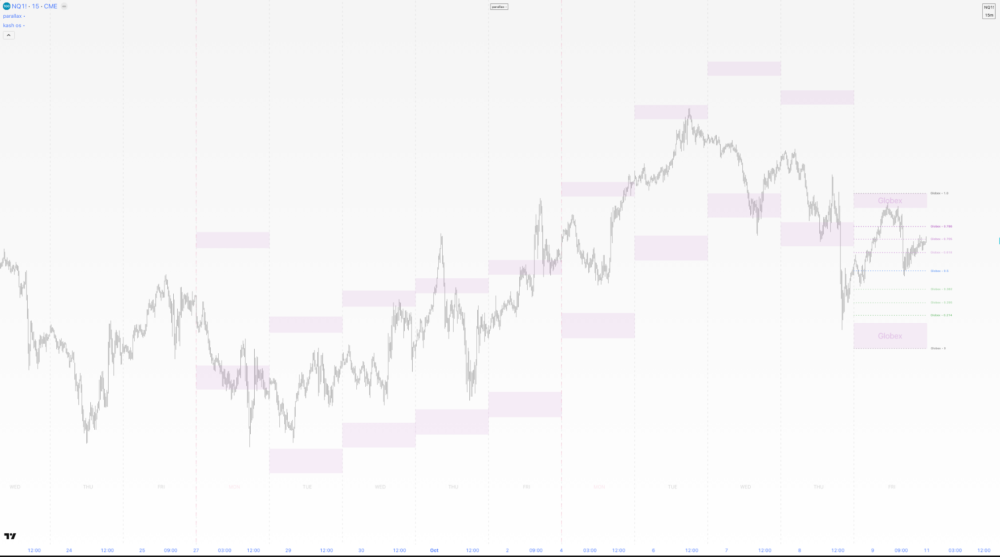
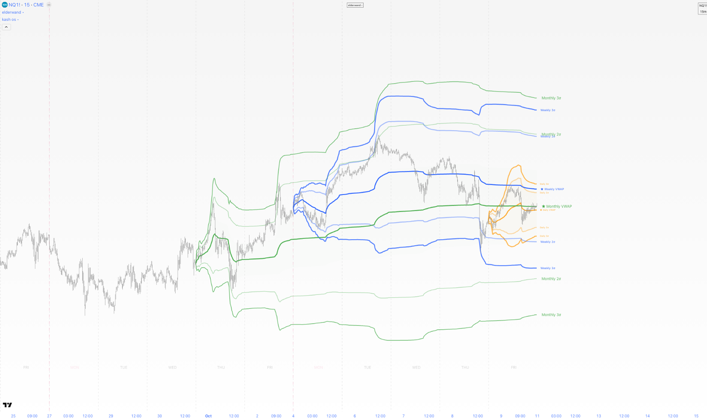
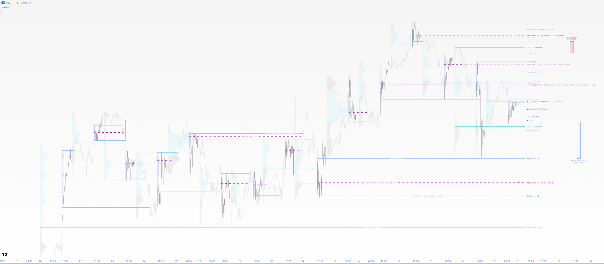
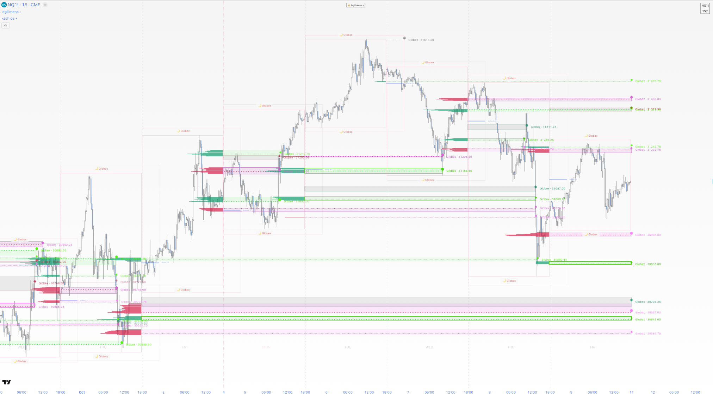

# indicators • by kash

A suite of custom trading indicators for TradingView, designed, built and used by me for day trading US stock-index futures. Each one answers a question a trader would otherwise work out by hand, chart after chart, and draws the answer directly on the price chart.

They are written in Pine Script, TradingView's own programming language.

## Why this is harder than it looks

Pine Script runs inside TradingView with tight rules:

- **The script runs once for every bar on the chart**, from the oldest to the newest, then again each time the price updates. Any memory of what happened earlier has to be designed and kept by hand.
- **There's a fixed limit on drawings.** A script can only show a few hundred lines, boxes and labels. Go over the limit and TradingView quietly deletes the oldest ones, so a tool can lose information without any warning.
- **Data from other timeframes is rationed.** A script can only make a limited number of requests for other timeframes, such as hourly or one-minute data on a daily chart. Careless use also lets future data leak into the past. This is called "repainting": the history looks better than what the trader actually saw live.
- **Charts aren't always based on time.** On Range charts a new bar forms after a fixed price move, not after a fixed number of minutes. Any logic built on times of day has to work there too, as well as in Bar Replay, where history is played back bar by bar.

Every indicator below solves a real trading problem within those limits.

## The indicators

### Kash OS

**The problem:** every chart needs the same reference points: where each day, week and month begins, and the round-number prices people watch. In futures, though, the trading day starts at 6 p.m. New York time, not at midnight.

**What it does:** draws day, week and month dividers on whichever boundary the trader chooses, labels the days of the week, and lays a grid of round-number prices around the current price.

**What was hard:** keeping the dividers exact across daylight-saving changes, weekend gaps, and markets with different hours (crypto trades every day, futures don't), while clearing away old dividers so the chart stays clean.

### Pulse

**The problem:** many traders place stop orders just beyond yesterday's high or last week's low, so price is often drawn to those levels, runs through them, and turns around. A trader wants to see every such level at once, know which have already been taken, and know how far past them price usually travels.

**What it does:** marks prior daily, weekly, monthly and session highs and lows, ends each one when price takes it out, and projects how far beyond it price tends to run, calibrated for each instrument.

**What was hard:**
- Telling a real break from a brief spike in thin overnight trading. A break during those hours is treated as provisional and only confirmed once the main session begins.
- Dozens of levels often sit at nearly the same price. Their labels are grouped and ranked so the most important one shows, within the drawing limit.

### Gaps

**The problem:** price often jumps between one session's close and the next session's open, and those gaps tend to get filled later. Tracking which gaps are still open, and how much of each has been filled, across days and weeks is tedious and easy to get wrong.

**What it does:** finds three kinds of opening gap, shows how much of each has been filled as price moves through it, and keeps the nearest unfilled gaps visible at the edge of the chart.

**What was hard:**
- On Range charts, bars don't line up with the clock, so there is no bar for "the 4:15 close". Gaps rebuilds each session from one-minute data behind the scenes and uses the chart's bars only for drawing.
- A gap only gets drawings while it's on screen, so many gaps fit within the drawing limit.

### Deviations

**The problem:** how far is price likely to travel today? The range of an early session is a useful ruler for the moves that follow it.

**What it does:** measures the range of five key trading sessions and projects zones at chosen multiples of each one. It also tracks:
- when those zones are reached
- when price pulls back
- how far price usually runs past the opening 30 minutes

**What was hard:**
- Five sessions, some crossing midnight, each with its own life cycle. The code runs as a fixed series of stages (detect, track, finalize, confirm, display), so adding a session means adding settings, not new code.
- Confirmations only use data that was complete at that moment, so the history never shows a signal the trader couldn't have seen live.

### ADR

**The problem:** every market has a typical daily range. Once the day has covered it, a further extension is less likely. An early move of about a third of that range is often a fake-out before the real move.

**What it does:** draws the average daily, weekly and monthly range from each period's open, split into thirds. It flags the early fake-out when it happens and shows how often recent days stayed inside each band.

**What was hard:**
- The levels have to be fixed at the open and never drift as the day goes on.
- They have to agree between live trading, Bar Replay and non-standard chart types.
- Each alert is sent only once per level per day.

### Parallax



**The problem:** Deviations and ADR answer "how far does price usually travel?" for one period at a time. A trader looking at several timeframes needs that answer for all of them together.

**What it does:** draws the expected travel range from the open for many periods at once: the week, the month, the day, two higher timeframes chosen to suit the chart, and six intraday sessions. It also:
- marks key ratios inside each range
- forecasts the next period's range
- flags days that break out of the expected range early

**What was hard:**
- TradingView rations the data requests a script can make, so all six intraday sessions are computed in a single request instead of six.
- Each layer of drawings gets its own share of the drawing limit, reserved up front, so a busy chart never silently loses lines.

### Elder Wand



**The problem:** many traders and institutions measure price against VWAP: the average price paid, weighted by volume, from a starting point such as the start of the day, week or year.

**What it does:** draws VWAPs from many starting points at once, with bands showing how far price usually strays from them.

**What was hard:**
- Smooth curves need a special drawing type that TradingView caps at 100 per script, so long histories are thinned to fit.
- When two starting points produce the same line (for example on the first day of a month), they are merged so nothing is drawn twice.

### Revelio



**The problem:** the prices where the most trading happened act as reference points later, because many participants hold positions there. To see them you need a volume profile: how much traded at each price, not just over time.

**What it does:**
- Builds volume profiles for each session, week, month and quarter.
- Marks the busiest price and the range holding most of the activity, and tracks when those levels are revisited or broken.
- Finds days whose busy ranges don't overlap, since those gaps often get filled later.

**What was hard:** a profile needs much finer data than the chart shows, sometimes second by second. Revelio picks the finest data available for the chart and still reaches back months for quarterly profiles. The code is organized into separately published libraries, Pine's equivalent of modules.

### Legilimens



**The problem:** volume shows how much traded, but not whether buyers or sellers were more aggressive. That difference, called delta, shows where one side took control.

**What it does:** builds a volume and delta profile for a chosen window, such as the New York morning, the overnight session or a Federal Reserve announcement day. It ranks the prices where buying or selling was unusually strong, and marks thin-volume areas where price tends to move quickly.

**What was hard:**
- TradingView doesn't provide trade-by-trade buy and sell data by default. Legilimens estimates delta from very fine-grained bars.
- It ranks prices to separate real outliers from noise.
- Like Revelio, it is organized into libraries.

### Aegis

**The problem:** before a trade, a trader needs to know exactly how much money is at risk, especially when entering in several pieces at different prices.

**What it does:** plans a trade with up to three entries, a stop and a target, and shows the average entry, the risk and the reward, both in money and as a reward-to-risk ratio.

**What was hard:**
- Given a maximum loss, Aegis works backwards to place the stop at a valid price, taking all the entries and quantities into account.
- It updates a fixed handful of drawings in place instead of recreating them.

## How it's built

- **Pine Script v6** throughout. The two largest indicators, Revelio and Legilimens, are split into libraries that are published and versioned on TradingView.
- **Custom checks.** Pine has no test framework of its own, so the repo has its own checks, written in JavaScript for Node:
  - A checker that rejects names Pine reserves for itself. It was added after one of those names broke a real build.
  - A checker for indicator titles, so work in progress is never released by mistake.
  - A checker that keeps library versions in sync with the indicators that use them.
  - Tests that run the indicators' core calculations outside TradingView, so mistakes are caught before they reach a chart.
- **Written code-quality rules:**
  - One clear setting rather than several that could contradict each other.
  - Shared logic written once.
  - No leftover code when a feature is removed.
  - Every drawing counted against the limit.
- **Tested on real charts.** Every change is checked in TradingView on standard charts, Range charts and Bar Replay before it's done.

## Archive

Earlier indicators that are complete but no longer actively developed.

**Gaps, zones and order flow**

- **MBZ Core:** finds five kinds of price gaps and marks the zones where price returns to a gap and is pushed back out. *Hard part:* grouping zones that form on the same bar, when Pine can't nest one list inside another.
- **SIF Core:** marks the candle that first entered a gap, once price later closes all the way through that gap. *Hard part:* remembering the candidate candle until the gap is either crossed or invalidated.
- **Implied FVG:** finds a subtle type of gap that only appears when one candle is unusually large compared with the ones before it.
- **FVG Atlas:** scans for gaps on up to six larger timeframes at once and shows them on a smaller chart. *Hard part:* reading the larger timeframes without repainting, while still checking live whether each gap has been filled.
- **Spectra:** a panel under the chart showing volume and buying-versus-selling pressure, colored by how unusual each bar is. *Hard part:* fitting a grid of values into the drawing limit by drawing only the bars on screen.

**Liquidity and targets**

- **MBZ Prime:** marks reversals that happen right after price takes out a prior high or low. *Hard part:* making each level identical on every chart timeframe, so a 1-minute chart and a 1-hour chart agree.
- **MBZ SIF Relay:** runs MBZ and SIF on four timeframes at once and passes the larger timeframes' zones down to the chart in view. *Hard part:* storing history in a form that didn't run out of memory during Bar Replay.
- **LTF Algo:** marks failed breakouts and the price targets they leave behind. *Hard part:* storing prices as whole price steps instead of decimals, so the same level is never drawn twice.
- **HTF Algo:** applies the same idea to monthly, weekly, daily and hourly candles, keeping only levels within a day's typical range.
- **Untagged Opens:** draws past candle openings that price hasn't come back to yet, as possible targets.
- **Hunter:** flags the first sign that a run of candles in one direction is reversing, optionally only on the right side of a key reference price.

**Time and range models**

- **DTT Intraday and DTT Weekly:** split the day into 15 named sessions, or the week into 4, and project each session's likely range from past behavior. *Hard part:* basing the projection on the middle half of past results rather than the average, so one extreme session doesn't distort it.
- **Ranges:** draws the opening and closing ranges of the trading day and the Monday range. *Hard part:* still finding the closing range on half-days, when the market closes early.
- **Chop:** a panel that tells trending markets from choppy ones.
- **News:** shows scheduled economic announcements on the chart, rated by expected impact.

## Repository layout

```
indicators/
├── 06-kash-os/  09-pulse/  13-gaps/  14-deviations/  15-adr/
├── 18-parallax/  19-elderwand/  20-revelio/  21-legilimens/  24-aegis/
└── archive/
scripts/        checks and tests
```

To try an indicator, open the Pine Editor in TradingView, paste in a `.pine` file, save it and add it to a chart.
